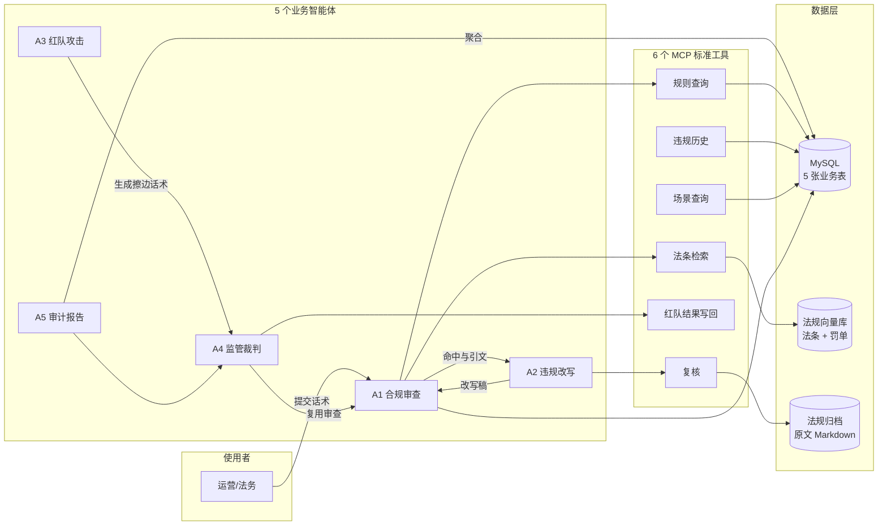

# Agent 流程图清单（D6 交付）

> **状态：生效** ｜ 最后更新：2026-11-03 ｜ 维护：统筹方
>
> 老师要求：**每个 Agent 都要有流程图，且节点要标注作用**。
> 这里每份文档都含三部分：**Mermaid 源码（可改）** + **节点作用表（文字）** + **失败行为**。
> PNG 由 `scripts/render_flows.py` 统一渲染到 `img/`。

## 一、整体协作



## 二、五个智能体

| 编号 | 智能体 | 一句话职责 | 文档 |
|---|---|---|---|
| A1 | 合规审查 | 双层检测 + 三重校验，输出分数、引文与法条 | [a1-合规审查智能体.md](a1-合规审查智能体.md) |
| A2 | 违规改写 | 据命中条款改写，**改写稿重新过审** | [a2-违规改写智能体.md](a2-违规改写智能体.md) |
| A3 | 红队攻击 | 按规则轴递进生成擦边话术（含合规对照） | [a3-红队攻击智能体.md](a3-红队攻击智能体.md) |
| A4 | 监管裁判 | 复用审查判定红队样本，产出漏杀/误杀清单 | [a4-监管裁判智能体.md](a4-监管裁判智能体.md) |
| A5 | 审计报告 | SQL 聚合出日报与压测报告，**默认不调模型** | [a5-审计报告智能体.md](a5-审计报告智能体.md) |

## 三、贯穿全部智能体的四条铁律

| 铁律 | 含义 | 体现在 |
|---|---|---|
| **分数由代码算** | 模型只举证，聚合与打分在代码里 | A1 的 N9 |
| **引不出法条即作废** | 命中必须带原文逐字片段 + 本轴声明的法条项 | A1 的 N6 |
| **未完成不算通过** | 判定没跑完记 -1，报告单列，绝不并入合规 | A1 / A4 / A5 |
| **不编造数字** | 空分母给 null，未计价给 null，不给伪合计 | A4 / A5 |

## 四、渲染方式

```bash
python -m scripts.render_flows                # 竖版（文档嵌入）
python -m scripts.render_flows --layout lr    # 横版（幻灯片）
python -m scripts.render_flows --layout both   # 两份都出
python -m scripts.render_flows --only a1       # 只重渲染某一份
```

脚本扫描本目录下的 `*.md`，把每个 ```mermaid 代码块通过 Kroki 渲染成 PNG 存到 `img/`。
**Mermaid 源码才是主文件**：改了流程先改 md，再重跑脚本出图，不直接改 PNG。

### 两种版式按用途选

| 版式 | 文件 | 典型尺寸 | 用在哪 |
|---|---|---|---|
| **竖版**（默认） | `a1-合规审查智能体.png` | 551×2822 | Word/PDF 文档嵌入、网页、GitHub |
| **横版** | `a1-合规审查智能体-lr.png` | 3622×366 | 16:9 幻灯片横向铺满一页 |

竖版 10 步链路会很长，横版会很长——这是"线性十步"本身的形状决定的，
不是渲染问题。答辩建议：**整体架构用 `README.png`（横版 2332×714，正好一页）**，
单个 Agent 讲细节时用竖版，配合本文档的「节点作用表」口头展开。

> GitHub 与多数 Markdown 编辑器（Typora / VS Code）本身能直接渲染 Mermaid，
> 所以即使不跑渲染脚本，文档也是可读的。

### 渲染依赖说明

Kroki 前面挂了 Cloudflare：Python 默认 UA 会被拦（403 / `error code: 1010`），
脚本里固定使用浏览器 UA，并在请求间留间隔、失败重试 3 次。
若公共接口不可用，可在本地用 `mmdc`（mermaid-cli）离线渲染，源码无需改动。
