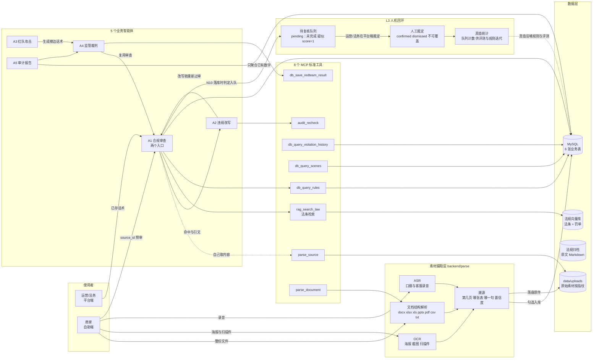

# Agent 流程图清单（D6 交付）

> **状态：生效** ｜ 最后更新：2026-11-04 ｜ 维护：统筹方
>
> 老师要求：**每个 Agent 都要有流程图，且节点要标注作用**。
> 这里每份文档都含三部分：**Mermaid 源码（可改）** + **节点作用表（文字）** + **失败行为**。
> PNG 由 `scripts/render_flows.py` 统一渲染到 `img/`。

## 一、整体协作



### 这张图里最容易被讲错的三个点

| 关系 | 为什么这样连 |
|---|---|
| 商家 → 素材摄取层 → A1 | 商家递来的是海报、报价表、录音，不是一条条话术。解析层负责把"整份文件"变成"逐条话术 + 位置"，A1 才有东西可判 |
| A1 ⇢ `parse_source` | 预审入口下，智能体自己去取内容，不依赖有人先把海报上的字抄进文本框 |
| A5 → `D1`（只读聚合） | 报告里的数字全部来自 SQL 聚合已有记录，**模型不参与造数**，所以 A5 不连向量库 |
| A1 → L3 人机回环 | 机器拿不准的（未完成/疑似/score=1）落库时标 `pending` 入队，人工裁定 `confirmed/dismissed` 后不可静默覆盖——这是"真值"的唯一来源，评测与规则迭代都靠它 |

## 二、五个智能体

| 编号 | 智能体 | 一句话职责 | 文档 |
|---|---|---|---|
| A1 | 合规审查 | 双层检测 + 三重校验 + 整篇复核，输出分数、引文与法条。**入口有两个**：已存话术 `script_id`、整份素材 `source_id`；拿不准的进 L3 人工复核队列 | [a1-合规审查智能体.md](a1-合规审查智能体.md) |
| A2 | 违规改写 | 据命中条款改写，**改写稿重新过审** | [a2-违规改写智能体.md](a2-违规改写智能体.md) |
| A3 | 红队攻击 | 按规则轴递进生成擦边话术（含合规对照） | [a3-红队攻击智能体.md](a3-红队攻击智能体.md) |
| A4 | 监管裁判 | 复用审查判定红队样本，产出漏杀/误杀清单 | [a4-监管裁判智能体.md](a4-监管裁判智能体.md) |
| A5 | 审计报告 | SQL 聚合出日报与压测报告，**默认不调模型** | [a5-审计报告智能体.md](a5-审计报告智能体.md) |

## 三、贯穿全部智能体的五条铁律

| 铁律 | 含义 | 体现在 |
|---|---|---|
| **分数由代码算** | 模型只举证，聚合与打分在代码里 | A1 的 N9 |
| **引不出法条即作废** | 命中必须带原文逐字片段 + 本轴声明的法条项 | A1 的 N6 |
| **未完成不算通过** | 判定没跑完记 -1，报告单列，绝不并入合规 | A1 / A4 / A5 |
| **不编造数字** | 空分母给 null，未计价给 null，不给伪合计 | A4 / A5 |
| **溯源以服务端为准** | 页码 / 段落 / 置信度由服务端重解析算出，客户端传来的不作数；对不上就拒绝入库 | 素材摄取层 N-1 |

## 四、渲染方式

```bash
python -m scripts.render_flows                # 竖版（文档嵌入）
python -m scripts.render_flows --layout lr    # 横版（幻灯片）
python -m scripts.render_flows --layout both   # 两份都出
python -m scripts.render_flows --only a1       # 只重渲染某一份
```

脚本扫描本目录下的 `*.md`，把每个 ```mermaid 代码块通过 Kroki 渲染成 PNG 存到 `img/`。
**Mermaid 源码才是主文件**：改了流程先改 md，再重跑脚本出图，不直接改 PNG。

### 两种版式按用途选

| 版式 | 文件 | 实测尺寸（2026-11-06 重新渲染） | 用在哪 |
|---|---|---|---|
| **竖版**（默认） | `a1-合规审查智能体.png` | 836 × 5654 | Word/PDF 文档嵌入、网页、GitHub |
| **横版** | `a1-合规审查智能体-lr.png` | 6788 × 596 | 16:9 幻灯片横向铺满一页 |

各图实测尺寸（`python -c "from PIL import Image;print(Image.open(...).size)"` 量出来的，不是估的；2026-11-06 全量重渲染）：

| 文档 | 竖版 | 横版 |
|---|---|---|
| A1 合规审查 | 836×5654 | 6788×596 |
| A2 违规改写 | 565×1544 | 2280×312 |
| A3 红队攻击 | 535×1902 | 2370×388 |
| A4 监管裁判 | 1304×1498 | 2096×634 |
| A5 审计报告 | 648×1894 | 2643×383 |
| 总览 README | 3966×1597 | 3966×1597 |

答辩建议：**讲整体架构用 `README.png`（3966×1597，横着一屏能铺开，含素材摄取层与 L3 人机回环）**，
单个 Agent 讲细节时用竖版，配合各文档的「节点作用表」口头展开。

> 注意：总览图的 Mermaid 源码本身就写 `flowchart LR`，所以 `--layout td` 与 `--layout lr`
> 产出**同一张图**（脚本只替换 `flowchart TD` 这一行）。这不是 bug，但别指望 `--layout both`
> 给总览图变出第二种形状；真要两种形状，得把源码改成 TD 再补一份 LR。

> GitHub 与多数 Markdown 编辑器（Typora / VS Code）本身能直接渲染 Mermaid，
> 所以即使不跑渲染脚本，文档也是可读的。

### 渲染依赖说明

Kroki 前面挂了 Cloudflare：Python 默认 UA 会被拦（403 / `error code: 1010`），
脚本里固定使用浏览器 UA，并在请求间留间隔、失败重试 3 次。
若公共接口不可用，可在本地用 `mmdc`（mermaid-cli）离线渲染，源码无需改动。
