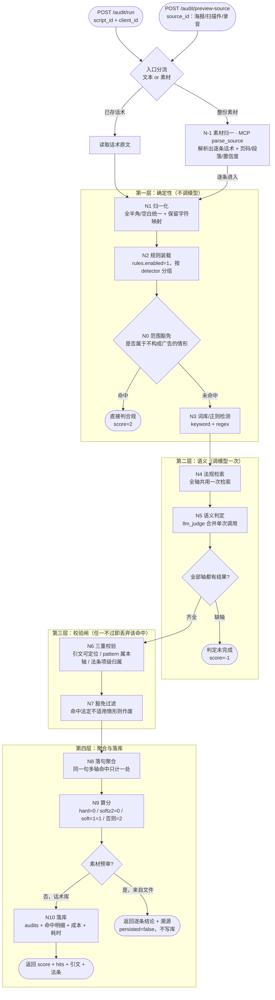

# A1 合规审查智能体 — 流程图与节点说明

> **状态：生效（D6-b 交付）** ｜ 最后更新：2026-11-04 ｜ 维护：统筹方
>
> 实测基线：单条话术 5.9 秒（关闭推理模式后），成本约 0.014 元。
> 关键设计：**分数由代码算，不由模型给**；**引不出法条即作废**。
> **入口有两个**：已存话术走 `script_id`（正式审查、落库）；整份素材走 `source_id`
> （海报/扫描件/录音，A1 自己调 `parse_source` 取内容，逐条预审、不落库）。

## 1. 流程图



## 2. 节点作用说明

| 节点 | 作用 | 输入 | 输出 | 失败时行为 |
|---|---|---|---|---|
| **入口分流** | A1 有两个入口：已存话术走 `script_id`；商家递来整份素材走 `source_id`。后者不等有人先把内容抄进文本框 | `script_id` 或 `source_id` | 待审文本（1 条或 N 条） | 两个 id 都没有 → 422 |
| **N-1 素材归一** | 调 MCP 工具 `parse_source` 重解析原始文件，得到逐条话术与溯源（第几页 / Sheet 第几行 / OCR 第几块 / 语音第几句）与置信度 | `sources` 行的 stored_path | `items_detail[]` | 文件被清理 → 报错；缺引擎 → 报"装什么"；**绝不返回空列表冒充成功** |
| **读取话术** | 按 id 取原文，校验话术与机构归属一致 | `script_id`、`client_id` | 话术原文 | 不存在 → 404；归属不符 → 422 |
| **N0 范围豁免** | 判断整条内容是否**根本不算广告**（如医学科普、机构信息公开），命中则整条放行 | 归一化文本 + 法定豁免清单 | 是否命中 | 清单缺失 → 跳过该步（不阻断） |
| **N1 归一化** | 统一全半角、空白、零宽字符；**同时保留字符位置映射**，供后面把引文回填成原文 | 原文 | 归一文本 + 位置映射 | 归一失败 → 整条未完成 |
| **N2 规则装载** | 从 `rules` 表读启用规则，按 `detector` 分组，决定哪些走词库、哪些走模型 | 规则库 | 规则集合 | 规则为空 → **判定未完成（不是合规）** |
| **N3 词库/正则检测** | 廉价确定性检测，毫秒级；命中的法条直接取规则表声明，不依赖检索 | 归一文本 + 规则 | 候选命中 | 单条规则异常 → 记轨迹，不影响其它轴 |
| **N4 法规检索** | 一次检索供全部语义轴共用，避免每轴各查一次 | 归一文本 | 法条候选 | 检索失败 → 降级为"仅规则表判定"，不阻断 |
| **N5 语义判定** | 一次调用判定全部语义轴，要求返回覆盖所有轴 | 文本 + 候选法条 | 各轴判定结果 | 缺任一轴 → **整体判定未完成** |
| **N6 三重校验** | ①引文必须能在原文逐字定位 ②pattern 必须属于本轴 ③法条必须属本轴声明的条项 | 候选命中 | 有效命中 | 任一不过 → 该条命中丢弃并记原因 |
| **N7 豁免过滤** | 命中后查该轴法定"不适用"情形，命中则作废 | 有效命中 + 豁免清单 | 过滤后命中 | 豁免清单为空 → 视为无豁免 |
| **N8 落句聚合** | 同一句话被多轴命中只计一处，避免一句重复扣分 | 全部命中 | 聚合后的命中 | 句号定位失败 → 按字符区间退避 |
| **N9 算分** | **纯代码计算**：任一 hard → 0；soft≥2 → 0；soft=1 → 1；否则 2 | 聚合命中 | 0/1/2 | 未完成 → **-1**（绝不等于合规） |
| **N10 落库** | 写审计记录：分数、命中、引文、法条、成本、耗时、是否未完成 | 最终结果 | `audits` 行 | 落库失败 → 报错，不返回虚假成功 |

## 3. 三道不可越过的闸门

| 闸门 | 防的是什么 | 违反后果 |
|---|---|---|
| **引文可定位** | 模型编造"用户没说过的话" | 该条命中作废 |
| **法条项级归属** | 模型凭记忆写法条号 / 跨轴乱引 | 该条命中作废（记 `cross_axis_rejected`） |
| **未完成即 -1** | 判定没跑完却被当成"没问题" | 分数 -1，报告里单列，**不计入合规** |

> 这三条是"可解释"与"可追责"的底线：宁可漏判，不可编造。

## 4. 输出字段

```json
{
  "score": 0,
  "hit_count": 2,
  "incomplete": false,
  "hits": [{
    "axis": "efficacy_claim",
    "law_article": "广告法第16条",
    "item_no": "第十六条(一)",
    "quote": "这个能保证你做完之后能往上走1—3个色度",
    "severity": "hard",
    "detector": "llm_judge",
    "reason": "……",
    "exempted_by": null
  }],
  "cost": "0.013745",
  "latency_ms": 40311,
  "disclaimer": "本系统输出为合规风险辅助提示，不构成法律意见"
}
```

`quote` 一定是**原文的逐字片段**（可直接在话术里搜到）；`item_no` 让用户知道到底触发了第几项。

## 5. 第二个入口：整份素材（海报 / 扫描件 / 录音）

商家递来的从来不是"一条话术"，而是一张海报、一份报价表、一段口播录音。
这条链路让 A1 自己去取内容，而不是等有人先抄进文本框。

| 对比项 | `POST /audit/run`（话术库） | `POST /audit/preview-source`（素材预审） |
|---|---|---|
| 输入 | `script_id` + `client_id` | `source_id`（+ 可选 `client_id`，商家账号强制本机构） |
| 取内容 | 读 `scripts.content` | 调 MCP 工具 `parse_source` **重新解析原始文件** |
| 判定次数 | 1 条 | 逐条，上限 20（与 batch 同口径，超出显式标 `truncated=true`） |
| 是否写库 | 写 `audits` | **不写**，返回 `persisted=false` |
| 单条模型故障 | 该条 `score=-1` 落库待人工 | 该条 `score=-1` + `incomplete=true`，其余继续 |
| 多返回的字段 | — | `ref`（第3页 / OCR块2 / 语音第4句）、`confidence`、`warnings` |

三个刻意的取舍：

1. **预审不落库**。"先入库再试"会把没打算留档的素材灌进业务表，之后所有审计统计都被污染；
   要留档就走 `commit=true` 入库，那时才有 `source_id` + 逐条溯源的正式记录。
2. **重解析而不是回放库里的话术**。智能体必须拿到与文件当前内容一致的文字，
   顺带也验证了溯源没有腐坏（文件被清理或换了版本会在这里立刻暴露，而不是静默给出旧内容）。
3. **归属校验以库为准**。`sources.client_id` 说了算，不看调用方传了什么——
   否则等于让前端自己声明"这份海报是我的"。

对应实现：`backend/tools/audit_tool.py:AuditTool.review_source`、
`backend/tools/ingest_tool.py:parse_stored / source_owner`、`backend/mcp_server/server.py:parse_source`。
回归用例：`tests/agents/test_source_entry.py`（入口分流、未完成标注、截断、越权拒、空条目不冒充成功）。
