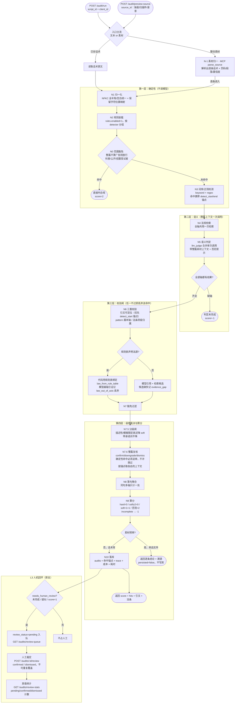

# A1 合规审查智能体 — 流程图与节点说明

> **状态：生效（D7 更新）** ｜ 最后更新：2026-11-06 ｜ 维护：统筹方
>
> 实测基线：单条话术 5.9 秒（关闭推理模式后），成本约 0.014 元。
> 关键设计：**分数由代码算，不由模型给**；**引不出法条即作废**；
> **正则/词库是召回器不是裁决者**——确定性命中必须送整篇复核（CLAUDE.md §5.1）。
> **入口有两个**：已存话术走 `script_id`（正式审查、落库）；整份素材走 `source_id`
> （海报/扫描件/录音，A1 自己调 `parse_source` 取内容，逐条预审、不落库）。

## 1. 流程图



## 2. 节点作用说明

| 节点 | 作用 | 输入 | 输出 | 失败时行为 |
|---|---|---|---|---|
| **入口分流** | A1 有两个入口：已存话术走 `script_id`；商家递来整份素材走 `source_id`。后者不等有人先把内容抄进文本框 | `script_id` 或 `source_id` | 待审文本（1 条或 N 条） | 两个 id 都没有 → 422 |
| **N-1 素材归一** | 调 MCP 工具 `parse_source` 重解析原始文件，得到逐条话术与溯源（第几页 / Sheet 第几行 / OCR 第几块 / 语音第几句）与置信度 | `sources` 行的 stored_path | `items_detail[]` | 文件被清理 → 报错；缺引擎 → 报"装什么"；**绝不返回空列表冒充成功** |
| **读取话术** | 按 id 取原文，校验话术与机构归属一致 | `script_id`、`client_id` | 话术原文 | 不存在 → 404；归属不符 → 422 |
| **N1 归一化** | 统一全半角、空白、零宽字符；**同时保留字符位置映射**，供后面把引文回填成原文 | 原文 | 归一文本 + 位置映射 | 归一失败 → 整条未完成 |
| **N2 规则装载** | 从 `rules` 表读启用规则，按 `detector` 分组，决定哪些走词库、哪些走模型 | 规则库 | 规则集合 | 规则为空 → **判定未完成（不是合规）** |
| **N0 范围豁免** | 只对含"科普/招募受试者/分诊/医保价格"等信号的句子调模型，判断整条内容是否**根本不算广告**；命中需有逐字引用证据 | 归一文本 + 法定豁免清单 | 是否命中 | 调用失败 → 记 `scope_failed`，**按未完成处理**，不静默放行 |
| **N3 词库/正则检测** | 廉价确定性检测，毫秒级。真身是 `_AXIS_REGEX`（`rules.pattern` 只对 llm_judge 生效）；每条命中携带 `detect_start/detect_end`——**同一词出现多次时锚点互不相同**（audit=257 实证修复） | 归一文本 + 规则 | 候选命中（带锚点 + needs_recheck=True） | 单条规则异常 → 记轨迹，不影响其它轴 |
| **N4 法规检索** | 一次检索供全部语义轴共用，避免每轴各查一次 | 归一文本 | 法条候选 | 检索失败 → 降级为"仅规则表判定"，不阻断 |
| **N5 语义判定** | 一次调用判定全部语义轴，**带整篇素材上下文与否定提示**（路线A）；要求返回覆盖所有轴 | 文本 + 候选法条 + 上下文 | 各轴判定结果 | 缺任一轴 → **整体判定未完成** |
| **N6 三重校验** | ①引文可定位：**优先用命中自带锚点**，校验切片与引文一致才敢用，对不上才退回 find ②pattern 属本轴 ③法条归属：规则表声明了法源的轴由**代码**用规则表绑定（`law_from_rule_table`），模型引用只验轴——越轴引证记 `law_out_of_axis` 丢弃该命中但**不算证据缺口**；轴没声明才走"模型引用+检索候选"，候选缺失记 `evidence_gap` | 候选命中 | 有效命中 | 任一不过 → 该条命中丢弃并记原因 |
| **N7 豁免过滤** | 命中后查该轴法定"不适用"情形（如经营理念表述），命中则作废但留痕 | 有效命中 + 豁免清单 | 过滤后命中 | 豁免清单为空 → 视为无豁免 |
| **N7.5 分级闸** | 带模糊限定词（可能/大约/应/因人而异）且**无承诺词**（保证/一定/百分百）的效果表述，从 hard 降为 soft——是"疑似违规"不是放行，同时标记送复核 | 命中列表 + 原文 | 分级后命中（downgraded + severity_before_gate） | 句中无限定词 → 保持原判，不降 |
| **N7.6 整篇复核** | 对语境有疑问的命中带整篇上下文二次裁决：`confirm` 维持 / `downgrade` 降软 / `dismiss` 撤销（必须留痕）。**确定性命中必须送审，任何 regex/keyword 命中不允许跳过复核直接结案**；每条命中按**自己的锚点**取上下文窗口（不再共享第一处，audit=257 错位根因已修） | 命中 + 整篇文本 | 处置后的命中 + trace | 复核调用失败 → **不改原判**记 `recheck_failed`——复核挂了不等于没问题 |
| **N8 落句聚合** | 同一句话被多轴命中只计一处，保留 axes/evidence 明细；全句均为降级才算降级 | 全部命中 | 聚合后的命中 | — |
| **N9 算分** | **纯代码计算**：任一 hard → 0；soft≥2 → 0；soft=1 → 1；否则 2 | 聚合命中 | 0/1/2 | incomplete → **-1**（绝不等于合规） |
| **N10 落库** | 写审计记录：分数、命中（含锚点与复核结论）、trace 全集、成本、耗时；`needs_human_review` 判定是否入复核队列 | 最终结果 | `audits` 行（review_status 可为 pending） | 落库失败 → 报错，不返回虚假成功 |
| **L3 人机回环** | 未完成/疑似/score=1 → `pending` 入队；运营在待复核页裁定 `confirmed`/`dismissed`（**写入后不可被静默覆盖**）；裁定数可统计（真值候选，供评测与规则迭代） | audits 行 | review_status 终态 + 统计 | 重复裁定 → 422 拒绝 |

## 3. 不可越过的闸门

| 闸门 | 防的是什么 | 违反后果 |
|---|---|---|
| **引文可定位（用锚点，不重搜）** | 模型编造"用户没说过的话"；同词重复时 find 重搜把多条命中定位到同一处（audit=257 实证：三个「永久」共享 129 锚点，判定与展示双错） | 该条命中作废；锚点链：detect_start → hit.start/end → 前端按区间渲染 |
| **法条归属在代码，不在模型** | 模型凭记忆编条号 / 跨轴乱引（s33 实证：efficacy_claim 引了不属本轴的指南第2条，被误记 evidence_gap 翻转成"未完成"） | 越轴丢弃记 `law_out_of_axis`，**不算证据缺口**；未声明轴仍 fail-closed |
| **确定性命中必须复核** | 词表零语境能力，"预防永久变色"的「永久」被当极限用语硬违规结案（a229 实证） | 跳过复核的分支已删除；复核失败不改原判 |
| **未完成即 -1** | 判定没跑完却被当成"没问题" | 分数 -1，报告单列，**不计入合规**，入 L3 复核队列 |

## 4. 输出字段

```json
{
  "score": 0,
  "hit_count": 2,
  "incomplete": false,
  "hits": [{
    "axis": "efficacy_claim",
    "law_article": "广告法第16条",
    "item_no": "第十六条(一)",
    "quote": "这个能保证你做完之后能往上走1—3个色度",
    "start": 155, "end": 176,
    "severity": "hard",
    "detector": "llm_judge",
    "reason": "……",
    "exempted_by": null
  }],
  "cost": "0.013745",
  "latency_ms": 40311,
  "disclaimer": "本系统输出为合规风险辅助提示，不构成法律意见"
}
```

`quote` 一定是**原文的逐字片段**；`start/end` 是它在话术内的**真实区间**——前端直接按区间渲染，不再用引文重新搜索。`recheck_verdict`/`recheck_reason` 记录复核对该命中的最终裁决（confirm 也留痕，"复核过维持原判"与"没复核"在轨迹里可区分）。

## 5. 第二个入口：整份素材（海报 / 扫描件 / 录音）

商家递来的从来不是"一条话术"，而是一张海报、一份报价表、一段口播录音。
这条链路让 A1 自己去取内容，而不是等有人先抄进文本框。

| 对比项 | `POST /audit/run`（话术库） | `POST /audit/preview-source`（素材预审） |
|---|---|---|
| 输入 | `script_id` + `client_id` | `source_id`（+ 可选 `client_id`，商家账号强制本机构） |
| 取内容 | 读 `scripts.content` | 调 MCP 工具 `parse_source` **重新解析原始文件** |
| 判定次数 | 1 条 | 逐条，上限 20（超出显式标 `truncated=true`） |
| 是否写库 | 写 `audits` | **不写**，返回 `persisted=false` |
| 单条模型故障 | 该条 `score=-1` 落库待人工 | 该条 `score=-1` + `incomplete=true`，其余继续 |
| 复核上下文 | 无素材来源 → 有语境信号才复核 | 整篇素材作为上下文与复核窗口来源 |

三个刻意的取舍：

1. **预审不落库**。"先入库再试"会污染业务表；要留档就走 `commit=true` 入库。
2. **重解析而不是回放**。智能体必须拿到与文件当前内容一致的文字，顺带验证溯源没腐坏。
3. **归属校验以库为准**。`sources.client_id` 说了算，不看调用方传了什么。

对应实现：`backend/agents/compliance.py`（N0–N9 主链）、
`backend/agents/audit/recheck.py`（N7.6）、`backend/agents/base.py`（检测器与锚点）、
`backend/tools/audit_tool.py`（入口与落库）、`backend/crud/audit.py`（L3 队列与真值统计）、
`backend/mcp_server/server.py:parse_source`。
回归用例：`tests/agents/test_hit_anchor.py`（锚点不共享）、
`tests/agents/test_coded_hit_recheck.py`（确定性命中必送复核）、
`tests/agents/test_reason_wording.py`（reason 禁表达分级意见）、
`tests/agents/test_source_entry.py`（素材入口）。
