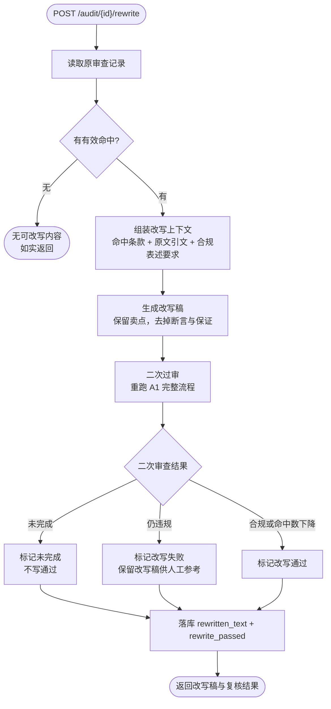

# A2 违规改写智能体 — 流程图与节点说明

> **状态：生效（D6 交付）** ｜ 最后更新：2026-11-03
>
> 核心纪律：**改写稿必须重新走一遍完整审查**（二次过审）。没过审就标"通过"，
> 等于换个说法继续违规，比不改更危险。

## 1. 流程图



## 2. 节点作用说明

| 节点 | 作用 | 失败/边界处理 |
|---|---|---|
| **读取原审查记录** | 取该次审查的命中与引文，作为改写依据 | 记录不存在 → 404 |
| **有有效命中？** | 没有命中就没有需要改的东西，不硬造改写稿 | 直接返回，不调用模型 |
| **组装改写上下文** | 把"违反了哪条、原话哪句、为什么违规"一起给模型，避免它瞎改 | 引文缺失 → 该命中不参与改写 |
| **生成改写稿** | 保留营销卖点，去掉功效断言/保证/绝对化表述 | 生成失败 → 记失败，不产生改写稿 |
| **二次过审** | **复用 A1 的完整流程**（同一份代码，不复制逻辑） | 二次审查未完成 → 标记未完成 |
| **判定通过** | 过审（score=2）**或**命中数下降，才算改写有效 | 两者都不满足 → 记 `rewrite_passed=0` |
| **落库** | 写 `rewritten_text` 与 `rewrite_passed` | 落库失败 → 报错，不返回虚假成功 |

## 3. 为什么"命中数下降"也算通过

合规改写常常把"保证白两个度"改成"效果因人而异"，判定从 hard 违规降到"轻微风险"（score=1）。
如果只认 score=2，会把**实质上已经消除主要风险**的改写判成失败，反而阻止系统给出有用产出。

因此通过条件是**并集**：`score=2` **或** `命中数 < 改写前命中数`。

## 4. 输出

```json
{
  "rewritten_text": "……",
  "rewrite_passed": true,
  "recheck": { "score": 1, "hit_count": 1, "hits": ["……"] }
}
```

`recheck` 原样带出二次审查结果，前端可展开对比"改之前几条、改之后几条"。
