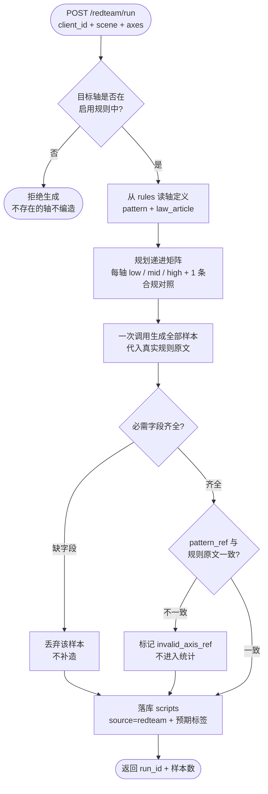

# A3 红队攻击智能体 — 流程图与节点说明

> **状态：生效（D6 交付）** ｜ 最后更新：2026-11-03
>
> 核心纪律：**轴的语义必须从 `rules` 表读，不能自己发明**。
> 早期版本让生成器自己理解"容貌焦虑"，结果生成的全是"促销紧迫"，
> 判出来一堆假漏杀——问题不在判定，在标签。

## 1. 流程图



## 2. 节点作用说明

| 节点 | 作用 | 失败/边界处理 |
|---|---|---|
| **校验目标轴** | 只允许压测规则库中真实启用的轴 | 轴不存在 → 直接拒绝，**不生成无依据的样本** |
| **读轴定义** | 从 `rules` 取该轴的判据原文（pattern）与法条 | 读取失败 → 中止，不使用模型自己理解的定义 |
| **规划递进矩阵** | 每轴 3 档强度 + 1 条**真合规对照**，保证四格矩阵有分母 | 轴数决定总量（如 4 轴 = 16 条） |
| **一次生成** | 单次调用产出全部样本，避免多次请求推高成本与时延 | 生成失败 → 本轮作废，如实记录 |
| **字段校验** | 每条必须有 轴/档位/话术/预期是否违规/策略说明 | 缺字段 → 丢弃该条，不补造 |
| **pattern_ref 校验** | 生成器引用的规则原文必须与库里**逐字一致** | 不一致 → 标 `invalid_axis_ref`，**不进统计** |
| **落库** | 写 `scripts`，`source=redteam`，`redteam_meta` 存 run_id/档位/预期标签 | 落库失败 → 报错 |

## 3. 为什么低档（low）最重要

高档话术（"保证白两个度"）用词库就能抓，压测价值低。
真正的价值在 **low 档**：那些"几乎合规"的话术——它们决定了系统的边界在哪。
第 4 轮实测里 2 条漏杀（`9-53`"正常恢复不用太担心"、`9-57`"属于专业标杆，口碑很稳"）
全部来自 low 档，正说明这一点。

## 4. 合规对照组为什么必须有

四格矩阵里误杀率的分母是 `FP + TN`。如果全部样本都是"预期违规"，
**没有对照组就没有 TN，误杀率算不出来**——只能证明"能抓"，不能证明"不乱抓"。
所以每轴固定配 1 条真合规对照（不承诺效果、不量化、不保证）。

## 5. 输出

```json
{
  "run_id": "rt_20261103_220500",
  "generated": 16,
  "script_ids": [49, 50, 51, 52, 53, 54, 55, 56, 57, 58, 59, 60, 61, 62, 63, 64]
}
```
