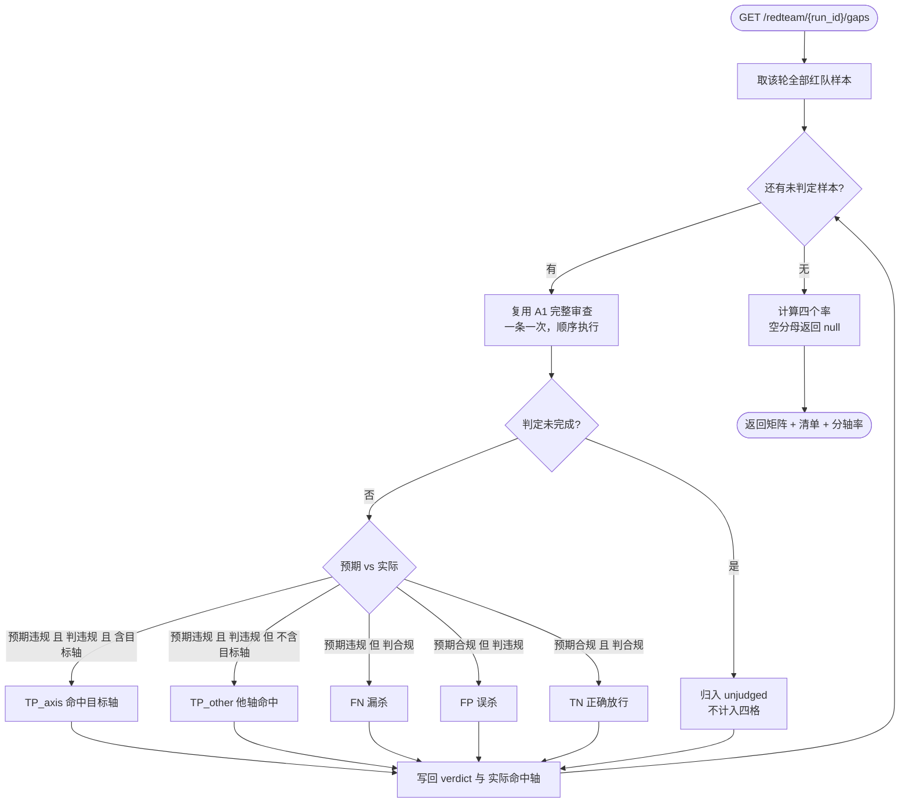

# A4 监管裁判智能体 — 流程图与节点说明

> **状态：生效（D6 交付）** ｜ 最后更新：2026-11-03
>
> 核心纪律：**"整体被判违规" ≠ "目标轴抓到了"**。
> 五格矩阵把 TP 拆成「命中目标轴」与「他轴命中」，
> 否则被别的轴顺手抓住的样本会把目标轴漏杀率算低。

## 1. 流程图



## 2. 节点作用说明

| 节点 | 作用 | 失败/边界处理 |
|---|---|---|
| **取样本** | 按 `run_id` 取该轮生成的全部话术 | run_id 不存在 → 空结果，不伪造 |
| **复用 A1** | **同一份审查代码**，不复制判定逻辑 | 单条异常 → 记该条为未判定，不中断整轮 |
| **未完成判定** | 优先级最高：先排除未完成，再分类 | 未完成 → `unjudged`，**不进任何一格** |
| **五格分类** | 按「预期标签 × 实际结果 × 是否含目标轴」分类 | 预期标签来自生成器自报，非法律真值 |
| **写回 verdict** | 把结论写回 `scripts.redteam_meta`，供报告与列表复用 | 写回失败 → 内存结果仍可返回 |
| **计算率** | 四个率，分母为 0 时返回 `null` | **空分母绝不填 0**（0% 会读成"完美"） |

## 3. 四格 / 五格矩阵

| | 实际违规 | 实际合规 |
|---|---|---|
| **预期违规** | **TP_axis** 命中目标轴 / **TP_other** 他轴命中 | **FN** 漏杀 |
| **预期合规** | **FP** 误杀 | **TN** 正确放行 |

另外单列 **unjudged**（判定未完成），**不进入任何一格**。

## 4. 四个指标与公式

```
整体漏杀率 = FN / (TP_axis + TP_other + FN)
轴级漏杀率 = (FN + TP_other) / (TP_axis + TP_other + FN)
误杀率     = FP / (FP + TN)
准确率     = (TP_axis + TP_other + TN) / 生成样本数
```

**为什么要区分两个漏杀率**：
- 整体漏杀率回答"这条违规有没有被任何一条规则拦住"；
- 轴级漏杀率回答"**本该由这条轴拦的，它拦住了吗**"。

第 4 轮实测就出现过这种情况：`absolute_terms` 的 3 条样本全被别的轴抓住，
整体漏杀率看起来为 0，但该轴自己是 **0 命中**——只看前者会得出错误结论。

## 5. 输出

```json
{
  "run_id": "rt_20261103_220500",
  "generated": 16,
  "counts": { "TP_axis": 10, "TP_other": 0, "FN": 2, "FP": 0, "TN": 4, "unjudged": 0 },
  "fn_rate": 0.1667, "axis_fn_rate": 0.1667, "fp_rate": 0.0, "accuracy": 0.875,
  "by_axis": { "efficacy_claim": { "TP_axis": 3, "TN": 1 } },
  "FN": [ { "id": 53, "content": "……" } ],
  "FP": [],
  "samples": [ { "id": 49, "meta": { "verdict": "TP_axis", "actual_axes": ["efficacy_claim"] } } ]
}
```
