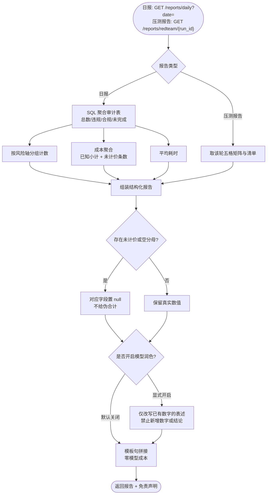

# A5 审计报告智能体 — 流程图与节点说明

> **状态：生效（D6 交付）** ｜ 最后更新：2026-11-03
>
> 核心纪律：**报告里的每个数字都必须能从 SQL 复算**。
> 因此默认**不调用模型**——让模型"写报告"就是给幻觉开门。

## 1. 流程图



## 2. 节点作用说明

| 节点 | 作用 | 失败/边界处理 |
|---|---|---|
| **判报告类型** | 日报与压测报告走不同聚合路径 | 参数非法 → 400 |
| **聚合审计表** | 一次分组查询完成总数/违规/合规/未完成 | 无数据 → 全 0，不报错 |
| **按轴分组** | 统计每个风险轴命中次数，用于分布图 | 无命中 → 空对象 |
| **成本聚合** | 已知小计 + 未计价条数**分别给** | 任一未知 → 合计为 `null` |
| **平均耗时** | 反映系统可用性 | 无数据 → 0 |
| **组装** | 统一结构，字段固定 | — |
| **空值规则** | 空分母 → `null`；含未计价 → 合计 `null` | **绝不填 0 冒充** |
| **模板句** | 默认用确定性模板生成摘要 | 零成本、零幻觉 |
| **模型润色** | 仅在显式开启时，把已有数字改写得更通顺 | **只许改表述，不许加数字** |

## 3. 为什么默认不调模型

| 方案 | 风险 | 结论 |
|---|---|---|
| 让模型"写日报" | 模型可能补出数据库里没有的数字、编造趋势 | ❌ |
| 纯 SQL 聚合 + 模板 | 数字必然可复算，答案唯一 | ✅ 默认采用 |
| 模板 + 模型润色 | 保留可复算性，但多一次成本与一次幻觉风险 | ⚠️ 显式开启才用 |

**核心判断**：报告的价值在于数字可信，不在于文字漂亮。

## 4. 未完成必须单列

日报里 `incomplete` 是**独立字段**，不混进合规数：

```json
{ "total": 38, "violations": 23, "compliant": 15, "incomplete": 0 }
```

如果把它们合并，一次"判定没跑完"的审查会被读成"这条没问题"——
这正是本系统最不能犯的错误。

## 5. 输出（日报）

```json
{
  "date": "2026-11-03",
  "total": 38, "violations": 23, "compliant": 15, "incomplete": 0,
  "violation_rate": 0.605,
  "average_latency_ms": 18279.71,
  "cost": null, "known_cost_subtotal": 0.103356, "unpriced": 30,
  "by_axis": { "efficacy_claim": 18, "safety_guarantee": 7 },
  "summary": "今日审查38条，未完成0条。",
  "disclaimer": "本系统输出为合规风险辅助提示，不构成法律意见，也不能替代《医疗广告审查证明》的行政前置审查。"
}
```

`cost` 为 `null` 表示**含未计价项**，同时给出 `known_cost_subtotal` 与 `unpriced` 条数，
让读者知道"已知多少、还有多少不知道"，而不是看到一个假的 0 元。
